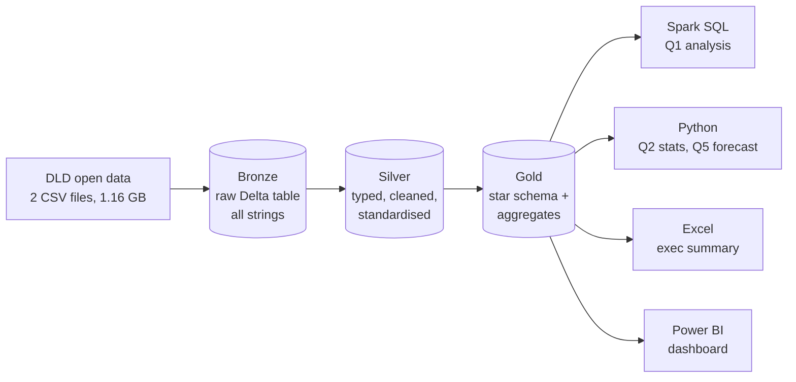

# Dubai Real Estate Transactions: Price Hotspots, the Off-Plan Market and a Sales Forecast

An end-to-end analytics project on **1.81 million registered real estate transactions in Dubai (1998 to November 2026)**. The pipeline runs from raw CSV files to a Databricks lakehouse, then to statistical analysis in Python, an Excel executive summary and a Power BI dashboard.

> **Status:** in progress. See the [roadmap](#roadmap) for which modules are complete.

---

## Business questions

| # | Question | Who cares | Methods |
|---|----------|-----------|---------|
| **Q1** | **Where are prices rising fastest?** Median AED per sq ft by community and unit type, year-on-year change, with a minimum sales volume so small samples don't distort the ranking. | Developers, brokers, property portals, investors | Spark SQL window functions, DAX time intelligence |
| **Q2** | **Off-plan vs ready:** is off-plan's share of sales still growing, and do buyers pay a premium or a discount per sq ft for off-plan in the same community and unit type? | Developers, research and investment teams | PySpark, hypothesis testing, bootstrap confidence intervals |
| **Q5** | **What happens next?** Seasonality of monthly sales volume and value, and a 6-month forecast. | Developers' sales planning, brokerages, banks | Time-series decomposition, ETS/SARIMA with backtesting, Excel `FORECAST.ETS` cross-check |

Plus an interactive Power BI page, **"What does my budget buy?"**: pick a budget and see where homes actually sold at that price.

---

## Tech stack

| Layer | Tool | What it's used for |
|-------|------|--------------------|
| Storage and processing | **Databricks (Free Edition)**, Delta Lake, Unity Catalog | Lakehouse with bronze, silver and gold layers |
| Transformation | **PySpark**, **Spark SQL** | Ingest, clean, model, aggregate 1.8M rows |
| Statistics and forecasting | **Python** (pandas, SciPy, statsmodels) in VS Code | Hypothesis tests, forecasting, backtesting |
| Stakeholder summary | **Excel** (Power Query, PivotTables, `FORECAST.ETS`) | One-page executive summary |
| Dashboard | **Power BI** (star schema, DAX, what-if parameters) | Interactive dashboard |
| Version control | **Git / GitHub** | Code, notebooks, documentation |

---

## Pipeline



---

## Data at a glance

Full profile: [`docs/data_profile.md`](docs/data_profile.md) · Column reference: [`docs/data_dictionary.md`](docs/data_dictionary.md)

- **1,814,844 transactions**, each with a unique ID, in two CSV files (47 columns, English and Arabic)
- **Sales 1,387,509 · Mortgages 359,126 · Gifts 68,209**
- Dates run from 1966 to 5 Nov 2026, but volumes before 1998 are tiny (fewer than 200 a year)
- **244 DLD areas, 161 master projects, 3,443 developer projects**
- Off-plan share of residential flat sales rose from **48% (2021) to 75% (2026 YTD)**

---

## Roadmap

| Module | What gets built | Status |
|--------|-----------------|--------|
| 0 | Setup: Databricks Free Edition, schema, volume, upload, GitHub repo | ✅ |
| 1 | **Bronze:** ingest raw CSVs into a Delta table | ✅ |
| 2 | **Silver:** types, dates, outlier flags, standardised rooms and communities, sq ft, data quality gate | 🔄 |
| 3 | **Gold:** star schema (fact sales, date, location and property dimensions) and aggregates | ⬜ |
| 4 | **Q1:** price hotspots in Spark SQL | ⬜ |
| 5 | **Q2:** off-plan vs ready, statistical comparison in Python | ⬜ |
| 6 | **Q5:** seasonality and 6-month forecast in Python, cross-checked in Excel | ⬜ |
| 7 | Excel executive summary | ⬜ |
| 8 | Power BI dashboard | ⬜ |
| 9 | Findings write-up and publish | ⬜ |

The step-by-step guides live in [`modules/`](modules/) and the concepts are explained in [`LEARNING.md`](LEARNING.md).

---

## Repository structure

```
Dubai_Real_Estate_Analytics/
├── README.md
├── LEARNING.md                  # Concepts explained, interview answers
├── requirements.txt             # Python packages for the VS Code part
├── data/sample/                 # 1,000-row sample (full data: see "Reproduce")
├── docs/                        # Data profile, data dictionary
├── modules/                     # Setup guide and module instructions
├── databricks/                  # Databricks notebooks (bronze, silver, gold, SQL)
├── python/                      # Statistics and forecasting notebooks
├── excel/                       # Executive summary workbook
├── powerbi/                     # .pbix and screenshots
└── solutions/                   # Reference solutions for the guided notebooks
```

---

## Reproduce

1. Download the Real Estate Transactions dataset from the Dubai Data portal: <https://data.dubai/en/l/470061>
2. Follow [`modules/00_setup.md`](modules/00_setup.md) to create a Databricks Free Edition workspace and upload the CSVs.
3. Run the notebooks in `databricks/` in number order, then the notebooks in `python/`.

The raw CSVs (1.16 GB) are not stored in this repo. A 1,000-row random sample is in `data/sample/` for a quick look.

---

## Data source, licence and disclaimer

- **Source:** Dubai Land Department real estate transactions, published on the Dubai Data portal (<https://data.dubai/en/l/470061>). Extract downloaded 6 November 2026.
- **Licence:** used under the Dubai Open Data Licence. Any adapted dataset shared from this project is made available under the same licence.
- **Disclaimer:** this is an independent portfolio project. It is not affiliated with, endorsed by or associated with the Dubai Land Department, the Government of Dubai or any government entity. The figures are my own analysis of the open data and are not official statistics.

---

## Author

**Rodwell Marimo** · [GitHub](https://github.com/marzrodie) · [LinkedIn](https://www.linkedin.com/in/rodwell-marimo-b824846a) · [Tableau Public](https://public.tableau.com/app/profile/rodwell.marimo)
