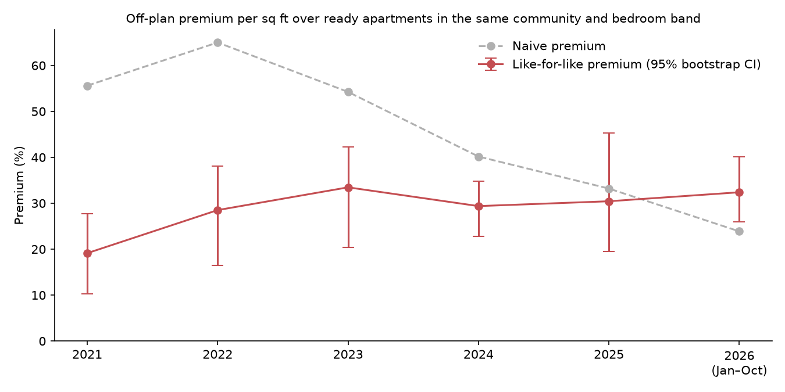

# Q2: Off-plan vs ready, is off-plan still taking share, and do buyers pay a premium?

> Fill in every `[ ]` from your own results in `python/05_q2_offplan_vs_ready.ipynb`. Delete these instruction lines when you're done.

**Scope:** apartment sales registered with the DLD, January 2021 to October 2026, price outliers excluded ([ ] sales). Premium = off-plan median AED per sq ft ÷ ready median − 1.

---

## Headline

> One sentence combining Finding 2 (the size of the premium) and Finding 3 (naive vs like-for-like going in opposite directions).

[ ]

---

## Finding 1: Off-plan's share keeps rising

- Off-plan rose from **[ ]%** of apartment sales in 2021 to **[ ]%** in 2025, and [ ]% in January–October 2026.

**So what:** [ ]

---

## Finding 2: Like for like, off-plan sells at a premium of about [ ]%

- Comparing off-plan with ready **inside the same community and bedroom band** ([ ] groups with 30+ sales on each side, covering [ ]% of 2025 apartment sales), the sales-weighted median premium in 2025 was **[ ]%** (95% bootstrap CI [ ]–[ ]%).
- A fixed-effects regression gives **[ ]%** (95% CI [ ]–[ ]%), so the two methods agree.
- Off-plan was dearer in **[ ]%** of groups. After Benjamini–Hochberg correction, [ ] of [ ] differences were statistically significant; in [ ] of them off-plan was *cheaper* ([examples]).
- Example: JVC 1-bed, the busiest group, showed a [ ]% premium (CI [ ]–[ ]%). A random off-plan sale there was priced above a random ready sale [ ]% of the time.

**So what:** [ ]

---

## Finding 3: The naive gap shrank, but the like-for-like premium grew

- The naive premium (all off-plan vs all ready) fell from **[ ]%** in 2021 to **[ ]%** in 2026.
- The like-for-like premium rose from **[ ]%** to **[ ]%** over the same period.
- The naive figure fell because off-plan volume shifted towards lower-priced communities (e.g. [ ], [ ]), not because buyers stopped paying more for off-plan. This is an example of Simpson's paradox.

**So what:** [ ]

---

## Method and limitations

- **Like-for-like groups:** year × community × bedroom band, with at least 30 off-plan and 30 ready sales.
- **Tests:** two-sided Mann–Whitney U (no normality assumption; consistent with median-based reporting); Benjamini–Hochberg false-discovery-rate correction across groups.
- **Uncertainty:** 2,000-resample bootstrap (by sale for single groups; by group for the market-wide premium); fixed-effects OLS on log price per sq ft with cluster-robust standard errors as a cross-check.
- **The premium is not "pure":** off-plan units are new, ready stock includes older buildings, and off-plan buyers get payment plans. This data can't separate newness, financing terms and expectations.
- **No unit ID:** the same unit can't be followed from off-plan purchase to later resale.
- **Source:** Dubai Land Department open data (Dubai Data portal), extract of 6 Nov 2026. Independent analysis, not official statistics.
